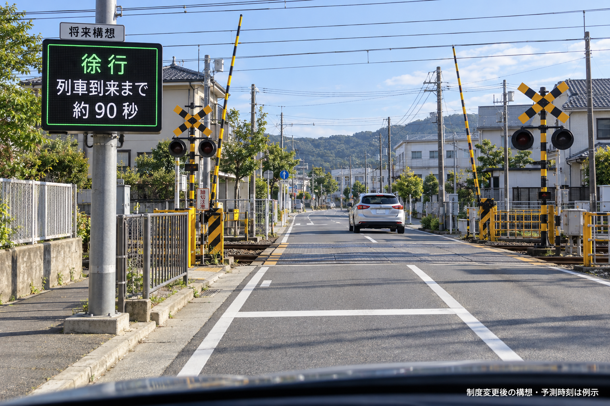

# 踏切みまもり | 設置と交通効果を説明するWeb PoC

列車の予告表示で道路交通を改善できるかを、実ダイヤの再生・交通モデル・視覚的な設置案で検討する自主開発プロジェクトです。React / TypeScript / FastAPIを使い、出典と仮定を明示して提案を説明できる状態にしました。

## 2026年10月10日版

- [ブラウザで体験する](https://dachone-sys.github.io/railway-crossing-notification/)
- [写真・配置図・計算式・提案先をまとめた説明資料](crossing-proposal.pdf)
- [改良版のソース一式](crossing-demo-source-2026-10-10.zip)
- [試算条件・結果・出典のJSON](quantitative-evidence.json)
- [現地観測の空テンプレート](field-observation-template.csv)

最新の再現可能なソースは上のZIPにまとめています。展開した `crossing-demo` 内が2026年10月10日改良版です。従来の `backend/` と `frontend/` は旧版の開発履歴として残しています。Web公開版 `index.html` は画像・画面・計算を含む単体ファイルで、APIなしで体験・提案・設置画面を利用できます。利用者・管理のデモAPI画面は、ローカルでサーバーを起動すると利用できます。



写真はAI生成の架空の設置イメージです。緑の「徐行」は制度変更後の構想であり、現行の通行指示ではありません。撮影された施工実績や安全認証を示していません。

## できること

1. **実ダイヤの体験**：小田急公式の海老名上り・座間下りの駅発車ダイヤ抜粋40件で、列車と踏切の模式図を再生。平日・休日切替、遅延仮定、CSV取込、結果保存。
2. **交通効果の比較**：現行一時停止、予告＋条件付き徐行、既存の踏切信号機連携を同じ条件で比較。車列グラフ、平均遅れ、容量、終了時車列、予告期間の感度分析。
3. **設置・根拠の説明**：昼間・雨天夜間・徐行状態の構想画像、4色＋文字＋予測時間の表示デモ、徐行区間の時間損失計算、公開実績、現地観測計画、相談先。
4. **異常シナリオ**：通信途絶、情報失効、警報、遮断機、出口渋滞、予測の早まり等を机上で検証。
5. **APIの接続口**：FastAPI・WebSocket、サーバー側のODPT接続準備。APIキーはソースやブラウザに含めません。

## 実データと仮定

| 区分 | 内容 |
|---|---|
| 公開された実データ | 小田急公式の駅発車ダイヤ抜粋、国土交通省の黒沢踏切整備事例 |
| 仮定 | 踏切までの走行時間、警報開始、遮断時間、道路需要、車頭時間、表示切替条件 |
| 未測定 | 座間14号の渋滞削減量、予測誤差、視認性、運転者の行動、安全性 |

下り通過列車等は未収録です。駅発車ダイヤは踏切を通る全列車のデータではありません。公開位置APIや時刻表だけでは安全な進入判断を保証できません。

仮定例（600台/時、停止5秒/台、徐行3秒/台、周期240秒、禁止45秒、予告停止30秒）では期間内平均遅れが61.0→8.2秒になります。これは現地改善率ではありません。徐行車頭時間を5秒/台にすると改善は0%です。60分後に残る車の将来遅れは未計上です。

国土交通省の黒沢踏切の実績は信号化によるものです。今回の予告装置の成果として流用していません。

## 起動・再現

ZIPを展開し、`crossing-demo/frontend` で以下を実行します。

```sh
npm ci
npm run dev
```

バックエンドを使う場合は、展開した `crossing-demo` で次を実行します。

```sh
python -m venv .venv
python -m pip install -r requirements.txt
python -m uvicorn main:app --port 8000
```

仮想環境を有効にしてから実行してください。ODPTは未登録・未接続でも基本の体験・計算画面を利用できます。

## 検証

```sh
# frontend 内
npm run build
npm run lint
node test-model.mjs
node test-timetable.mjs
node export-evidence.mjs

# プロジェクト直下
python -m unittest test_api.py test_rail_feed.py
```

車両数保存、容量、過飽和、改善なしの条件、時間境界、異常判定、重複遮断区間、CSV・時刻入力を確認しています。PDF全8ページは画像に描画して確認。Web版の状態切替と画像読み込みもブラウザで確認しています。

## ポートフォリオとして示せること

社会課題の整理、一次資料の調査、データの出典管理、Reactの画面設計、交通モデル実装、FastAPI接続設計、検証、説明資料の作成までをまとめた成果物です。生成AIを開発・構想画像作成に活用しています。実設備の開発・導入実績や行政の承認実績ではありません。

## 主な出典

- [道路交通法 第33条](https://laws.e-gov.go.jp/law/335AC0000000105)
- [国土交通省・黒沢踏切の事例](https://www.mlit.go.jp/road/sisaku/fumikiri/pdf/jirei_03.pdf)
- [FHWA・車頭時間と交通容量（2008年版・参考）](https://ops.fhwa.dot.gov/publications/fhwahop08024/chapter3.htm)
- [国土交通省・道路標識の設置方法](https://www.mlit.go.jp/road/sign/annai/setting02.htm)
- [小田急・海老名駅](https://www.odakyu.jp/station/ebina/)、[座間駅](https://www.odakyu.jp/station/zama/)

データの出典URLとダイヤ改正日はJSON・アプリ内にも記載しています。第三者のデータの権利は各提供者に帰属します。

## 相談先と次の課題

座間14号の候補では、県道407号の道路管理について神奈川県・厚木土木事務所東部センターへ相談し、県警・小田急・海老名市との共同検討を目指します。まず現状観測と監視のみの検証を提案します。連絡の送信や実証契約は未実施です。

このPoCは説明・机上検証用です。現在の公道では一時停止義務・現地の信号、警報機、遮断機に従ってください。改善量の現地測定、表示の理解・急加速誘発の評価、管理責任・費用・法制度の確認が次の段階です。

お問い合わせ・不具合はこのリポジトリのIssuesへ。
